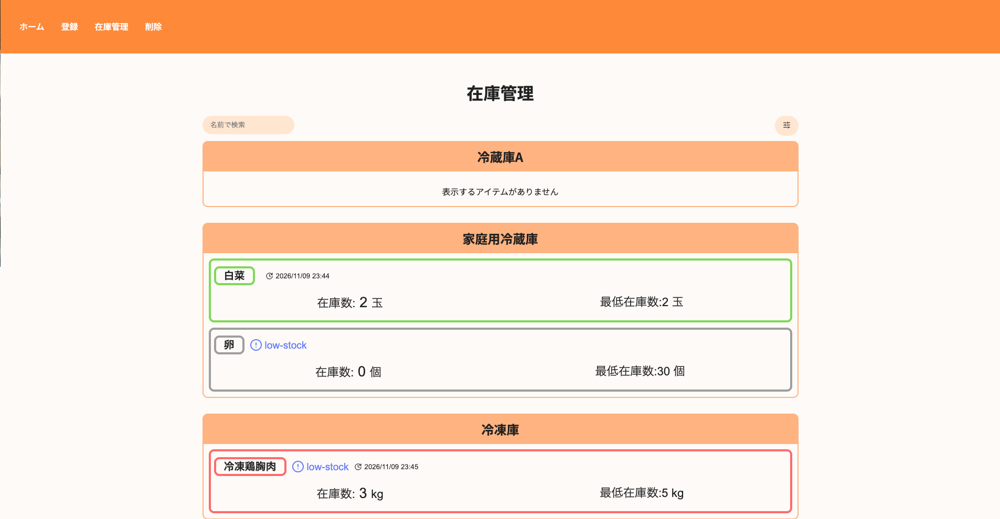
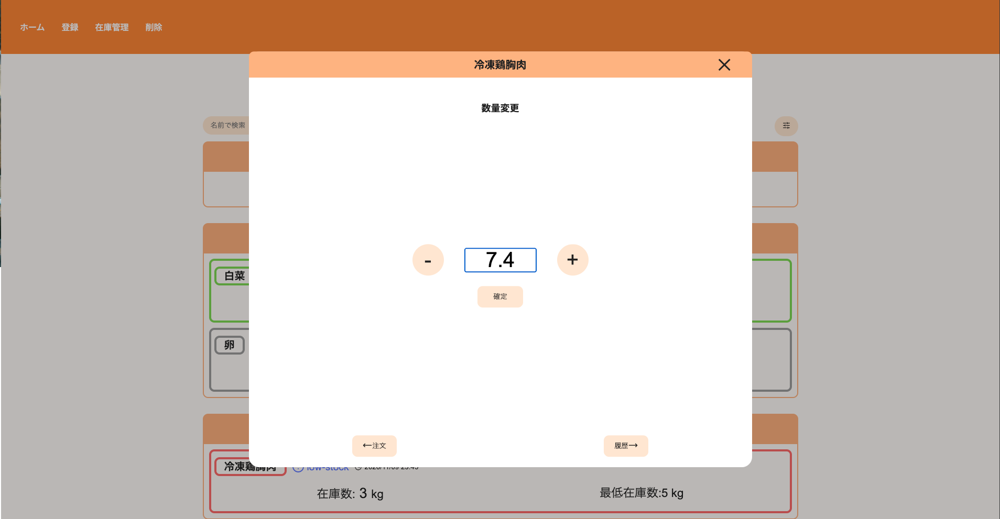
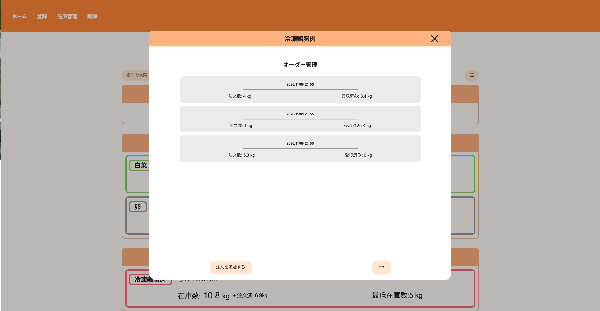
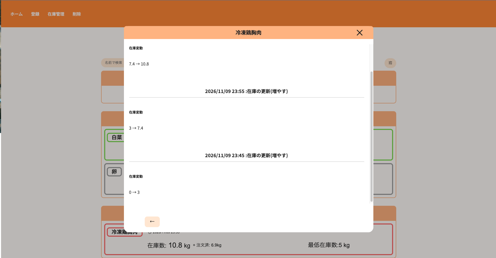
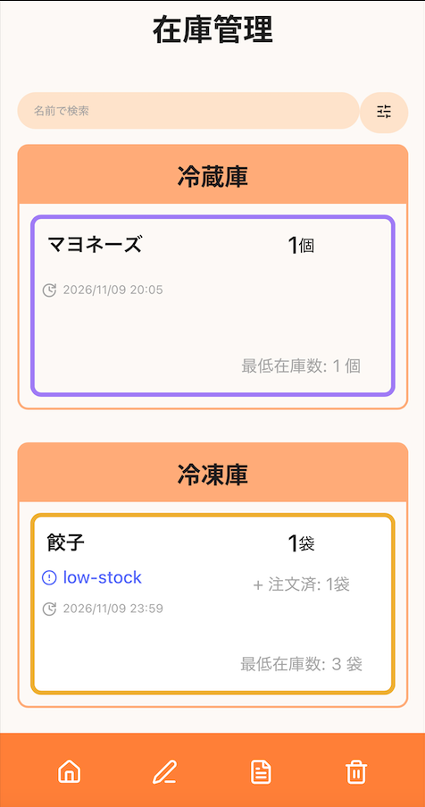

# 在庫管理アプリケーション

**デモ** https://inventory-management-alpha-wine.vercel.app

## 1. 概要

### 1.1 このアプリケーションについて

このアプリケーションは在庫数の変動を数え、アプリケーション上に記録することにより、在庫数の管理を簡素化します。
また、アイテムごとに幾つかの属性を設定することで、注文の管理や在庫補充のタイミングの通知などを受けることができます。

### 1.2 動機について

独学で学んだWEBエンジニアリングの知識を具体化させるため、実際のアプリケーションの開発を考えました。
また、私のアルバイト先では、在庫管理は全て人により行われており、数え間違えや注文忘れが発生することが多かったため、そのような状況の改善のためこのアプリケーションの開発を始めました。

## 2. 機能

 - 保存先ストレージと保存アイテムの登録と削除
 - 保存されたアイテムの在庫数変更
 - 注文の管理
 - 在庫変動履歴の確認
 - アイテム検索と絞り込み
 - レスポンシブデザイン

## 3. スクリーンショット

### 在庫管理


### 数量変更


### 注文管理


### 在庫変動履歴


### モバイル表示


## 4. 技術スタック

 - React
 - JavaScript
 - CSS
 - Vite
 - React Router
 - Vitest
 - localStorage

## 5. 構造とデザイン

### 5.1 コンポーネント

このアプリケーションは主に以下の３つのセクションから構成されています。

 - 登録(ストレージと食材)
 - 在庫管理
 - 削除(ストレージと食材)

また、各セクションはそれぞれユーザーのアクションに応じたパネルがあり、それぞれのパネルは上記の３つのコンポーネントを親とし、子コンポーネントとして構成されています。

### 5.2 state管理

それぞれのセクションにおいて、パネルの管理等にのみ使用される変数はそれぞれのセクションの親コンポーネント内で宣言され、必要に応じて子コンポーネントに渡されます。

contextは主に２種類のデータで使用されています。

#### 5.2.1 AppDataContext

「appData」はアプリケーション上でユーザーが登録した情報を管理するデータです。
このデータはそれぞれのセクションを超えて、さらに複数の子コンポーネントで使用されるため、プロップドリリングを避けるためcontextにより必要なコンポーネントでのみアクセスします。

「loadStatus」はローカルストレージからのデータ読み込み状態に加え、データ保存時のエラー状態を管理する変数です。状態に応じて通常のアプリケーション画面、データ読み込みエラー画面、保存エラー画面を切り替えて表示します。

#### 5.2.2 InventoryNavigationContext

このcontextは在庫管理セクションにて使用されます。
在庫管理セクションには、数量管理を行うパネル、さらに下の階層に「deeperSection」である注文管理と在庫変動履歴があります。これらも同様に、構造上親コンポーネントにて宣言された変数に影響を与えるため、プロップドリリングを避けるため、contextが使用されています。

### 5.3 データ保存領域とバリデーション

このアプリケーションではブラウザのローカルストレージが使用されています。
またデータの読み込み時と保存時にバリデーションを行い、データが不正な場合、結果に応じたセクションが表示されます。

### 5.4 数量計算

このアプリケーションでは小数点第一位までの入力が可能です。
また、JavaScriptによる小数点を含む計算の不具合を避けるため、数量に関する値は10倍されて保存されており、数量計算はこの値を用い行われます。これらの値がユーザーに向けて表示される場合のみ値は10で割られ、反映されます。

## 6. ローカル環境での実行方法

### 6.1 必要な環境

- Node.js（プロジェクトの依存関係に対応するバージョン）
- npm
- Git

### 6.2 インストール

リポジトリをクローンします。

```bash
git clone https://github.com/Mamo2042-stack/inventory-management.git
cd inventory-management
```

依存パッケージをインストールします。

```bash
npm install
```

### 6.3 開発サーバーの起動

```bash
npm run dev
```

ターミナルに表示されたローカルURL（通常は `http://localhost:5173/`）にアクセスすると、アプリケーションを利用できます。

### 6.4 テストの実行

```bash
npm run test -- --run
```

### 6.5 本番用ビルド

```bash
npm run build
```

ビルドが成功すると、`dist` ディレクトリに本番環境向けのファイルが生成されます。

## 7. 技術的制限

このアプリケーションは記憶領域にブラウザーのローカルストレージが使用されております。
バックエンドとデータベースは含まれておらず、複数人での保存データの共有はできません。

## 8. 将来性

このアプリケーションは主にフロントエンド技術にフォーカスして作成されています。
将来的には、

 - バックエンド、データベースの導入
 - ユーザー認証機能の追加

また、保存データの読み込みやアップデート時のエラー発生時におけるデータの復旧に関しては、将来的にエラーの原因となるデータのみの修正機能の組み込みが考えられます。

加えて、実際の使用者のフィードバックを基に機能の拡大や改善を予定しております。